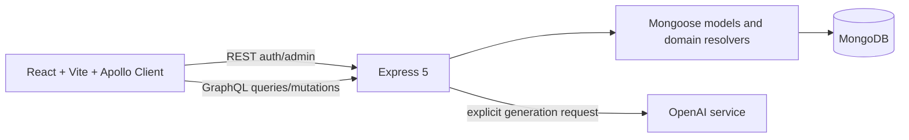

# DevClass

DevClass is a full-stack academic journal for language schools. It helps teachers
organize semesters, classes, students and enrolments, record classroom evidence,
and prepare reviewable messages and feedbacks.

The repository contains the Node.js API and the React application in `frontend/`.
It is a collaborative academic project; its history and team credits remain part
of the project context.

## Product scope

- JWT authentication and account administration.
- Classes, academic periods, students, guardians and enrolments.
- Lessons, skill-based daily records and historical archiving.
- Partial and final feedbacks with manual editing and review.
- Explicit, on-demand OpenAI generation for daily messages and feedbacks.
- Manual confirmation after a teacher sends a message through an external channel.

DevClass does not send email or WhatsApp messages. The application stores only the
teacher's confirmation that an external communication was completed.

## Architecture



REST handles authentication and administrator operations. GraphQL handles the
pedagogical domain: classes, students, enrolments, lessons, records and feedbacks.
The OpenAI service is called only by an explicit user request, and the result can
be edited before a teacher confirms external delivery.

## Technology

- Node.js, CommonJS and Express 5
- Apollo Server 5 and GraphQL
- MongoDB with Mongoose
- React, Vite, React Router and Apollo Client 4
- JWT, bcryptjs, dotenv and the OpenAI SDK

## Getting started

Requirements: Node.js 18+, MongoDB, and npm.

```bash
cp .env.example .env
# Set fictional/local values in .env. Never commit this file.
npm ci
npm start
```

In a second terminal:

```bash
cd frontend
cp .env.example .env
npm ci
npm run dev
```

The Vite development server proxies `/auth`, `/api/admin` and `/graphql` to the
API. Set `DEV_API_TARGET` in `frontend/.env` when the API runs elsewhere. The
OpenAI key is optional for startup; generation requests report
`IA_NOT_CONFIGURED` when it is absent.

## API surface

| Method | Path | Purpose |
| --- | --- | --- |
| POST | `/auth/register` | Register a teacher |
| POST | `/auth/login` | Authenticate and issue a JWT |
| GET | `/admin/usuarios` | List users for an administrator |
| PATCH | `/admin/usuarios/:id/status` | Activate or deactivate a user |
| POST | `/graphql` | Classes, students, enrolments, lessons, records and feedbacks |

The admin routes require a Bearer token with the `admin` role. Detailed GraphQL
examples and presentation material remain in `MDs/`, `docs/` and the Postman
collections already present in the repository.

## Contributions and team context

Thayslan Costa's verifiable work is represented by branch
`frontend-fase-5-thayslan` and commit `aff95d4`, which adds the final feedback and
lesson-record workflows on top of earlier team phases. The history also preserves
work from Walter Luan, Joao Vitor, Ramon Trindade and Pedro Henrique. This file
does not claim individual ownership of the complete application.

## Verification and status

```bash
cd frontend
node --test tests/feedbacks.test.cjs tests/fluxos.test.cjs
npm run lint
npm run build
```

The project is suitable for local demonstration with MongoDB and fictional data.
Browser-level verification, persistence tests against a real MongoDB, and AI calls
remain environment-dependent. No deployment or public demo is claimed.

DevClass originated in the `lubrias/devclass-backend` team repository. Any future
portfolio branch must retain that provenance and the collaborators' credits.